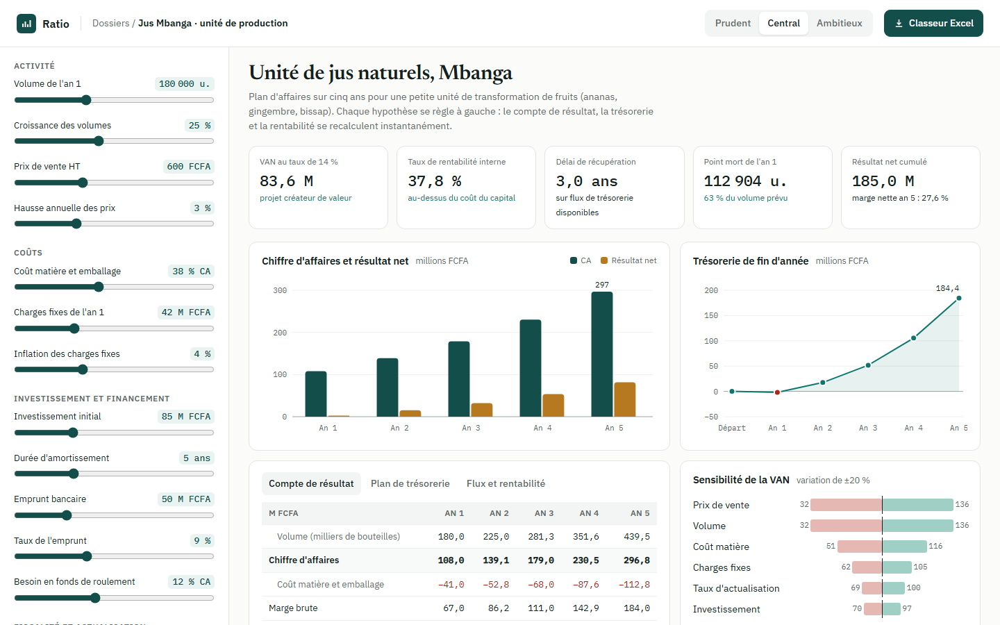
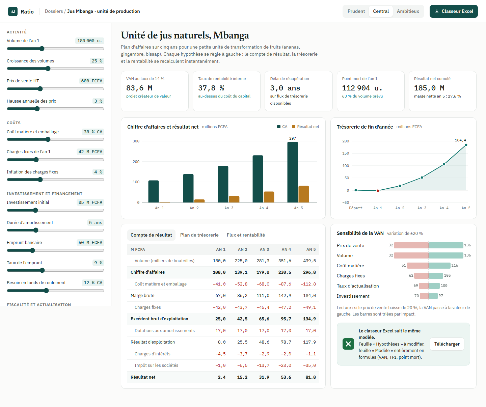
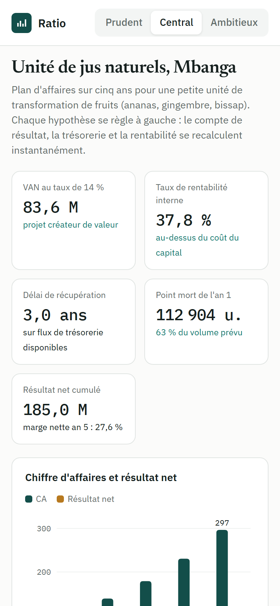

# Ratio

**Modèle financier et plan d'affaires** — Modèle financier sur cinq ans pour le plan d'affaires d'une unité de jus naturels : seize hypothèses réglables, compte de résultat, plan de trésorerie avec emprunt et BFR, flux disponibles actualisés, VAN, TRI, délai de récupération, point mort, trois scénarios et analyse de sensibilité. Livré avec un classeur Excel généré en Python dont toutes les cellules de calcul sont des formules.

**Démo en ligne : [https://lordlennyx.github.io/ratio-modele-financier/](https://lordlennyx.github.io/ratio-modele-financier/)**

Spot de présentation (30 s) : [media/spot-30s.mp4](https://lordlennyx.github.io/ratio-modele-financier/media/spot-30s.mp4)

## Ce que le projet montre

- Hypothèses réglables : volumes, prix, coûts, charges fixes, investissement, emprunt, BFR, impôt, actualisation
- Compte de résultat, plan de trésorerie et tableau des flux actualisés sur cinq ans
- Indicateurs : VAN, TRI par dichotomie, délai de récupération, point mort, marge nette
- Scénarios prudent, central et ambitieux
- Diagramme de sensibilité de la VAN à ±20 % trié par impact
- Classeur Excel à formules (IPMT, PPMT, NPV, IRR) généré avec openpyxl

## Réalisation

- **Stack :** HTML, CSS, JavaScript natif, SVG, Python (openpyxl), Excel
- **Typographies :** IBM Plex Sans, IBM Plex Mono, Newsreader
- **Évolutions possibles :** simulation de Monte-Carlo, bilan prévisionnel complet, import des données comptables, export PDF du dossier bancaire

| Bureau | Mobile |
|---|---|
|  |  |

---

Client et contenus fictifs, créés pour la démonstration. Conception, design et développement : **Njundiyimun Béchard** — [github.com/LordLennyx](https://github.com/LordLennyx)
